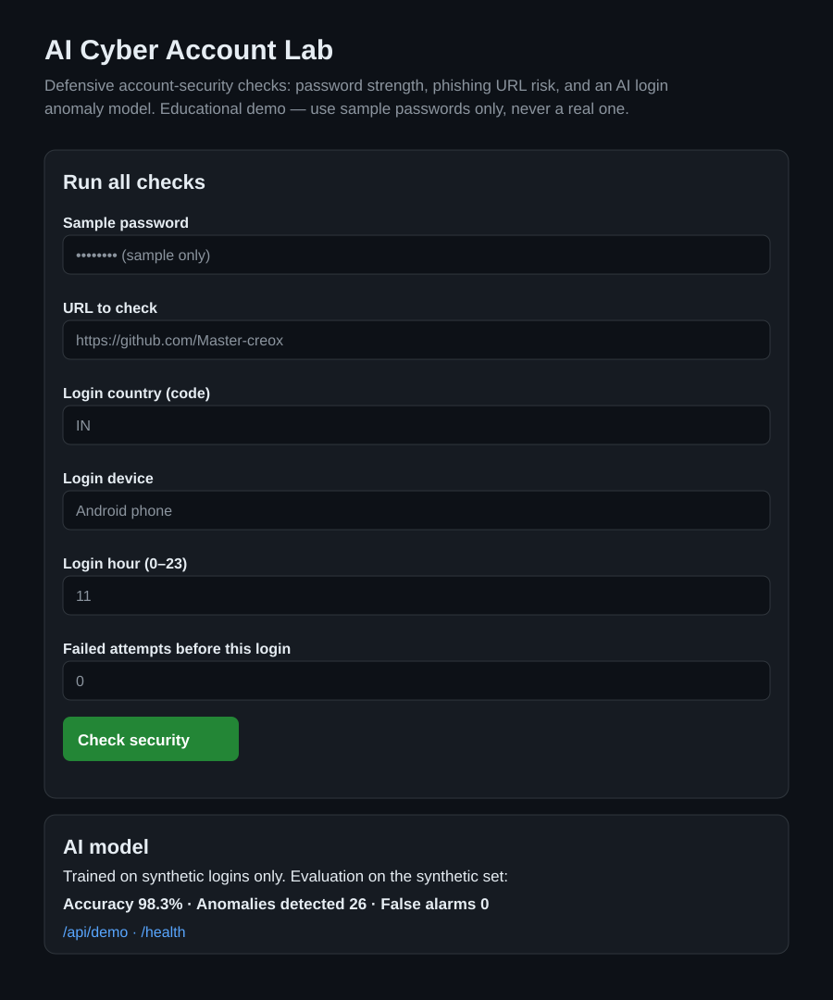
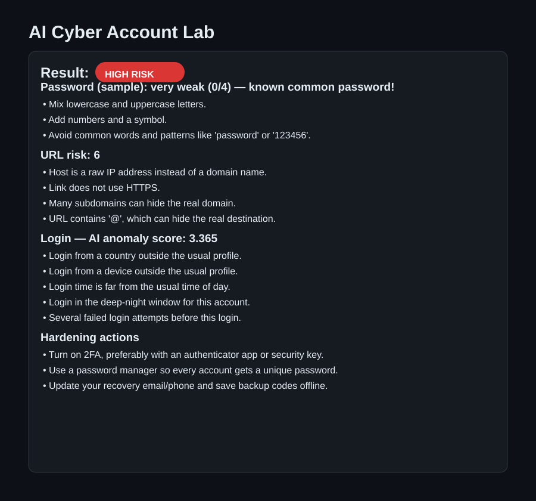

# AI Cyber Account Lab

AI + Cybersecurity lab to protect account security — detecting suspicious logins, weak passwords, and phishing risks.

> Defensive, educational project. It helps users and developers protect accounts. It does not collect, store, or transmit real passwords or private account data.

## Why this project?

Most account takeovers start with simple weaknesses: reused or weak passwords, phishing links, missing two-factor authentication (2FA), and logins that do not look like the account owner. This lab combines classic cybersecurity rules with machine-learning ideas to spot those risks early.

## Features (starter)

- **Password strength analysis** — length, character variety, and common-pattern checks with clear feedback. Passwords are assessed locally and never stored.
- **Login anomaly detection** — rule-based flags for unusual login time, device, or location, plus an **AI anomaly model** trained on synthetic logins (see `src/ai_anomaly.py` and `data/sample_logins.csv`).
- **Common-password check (privacy-preserving)** — a sample password is SHA-256 hashed in memory and compared only against hashes of very common passwords. It is never stored.
- **CLI + unified report** — run every check together and get an explainable report (see below).
- **Web dashboard** — a local dashboard (standard library only, no installs) with a check form, results, and a JSON API (see below).
- **Phishing risk checks** — heuristic checks for suspicious URLs, such as look-alike domains, IP-address links, and excessive subdomains.
- **Account safety guidance** — a practical checklist for 2FA, recovery options, and session hygiene.

## Project structure

```
.
├── data/
│   └── sample_logins.csv        # synthetic dataset (no real user data)
├── docs/
│   ├── account-security-checklist.md
│   └── threat-model.md
├── scripts/
│   └── generate_dataset.py
├── src/
│   ├── __init__.py
│   ├── account_safety.py
│   ├── ai_anomaly.py            # AI anomaly model + synthetic data generator
│   ├── breach_pattern.py        # hashed common-password check
│   ├── cli.py
│   ├── login_anomaly.py
│   ├── password_strength.py
│   ├── phishing_detector.py
│   ├── report.py                # unified, explainable report
│   └── web_dashboard.py         # WSGI dashboard + JSON API
├── tests/
├── dashboard.py                 # web dashboard entry point
├── main.py
├── requirements.txt
└── README.md
```

## Quick start

```bash
git clone https://github.com/Master-creox/ai-cyber-account-lab.git
cd ai-cyber-account-lab
python -m venv .venv
# Windows: .venv\Scripts\activate
# macOS/Linux: source .venv/bin/activate
pip install -r requirements.txt
pytest
```

## Run the lab (CLI)

```bash
python main.py demo
python main.py url https://github.com/Master-creox
python main.py login --country RU --device "Unknown Linux" --hour 2 --failed-attempts 4
python main.py dataset --output data/sample_logins.csv
python main.py password
```

`demo` runs every check on sample inputs, prints an explainable report, and
evaluates the AI anomaly model on the synthetic dataset.

## Web dashboard

```bash
python dashboard.py
# open http://127.0.0.1:8000
```

- `/` — check form (sample password, URL, login details) with an explainable result
- `/api/demo` — JSON report + AI model evaluation
- `/health` — health check

### Dashboard previews

Rendered previews of the dashboard (home and a sample HIGH RISK result):





The dashboard runs locally only by default. Sample passwords are assessed in
memory, never stored or echoed back. Do not expose this demo to the internet
without adding real authentication, HTTPS, and rate limiting.

Try the password checker in Python:

```python
from src.password_strength import assess_password

result = assess_password("Correct horse battery staple 42!")
print(result.score, result.label)
print(result.feedback)
```

## Roadmap

- [x] Starter structure, password strength, phishing heuristics, login-risk rules
- [x] Synthetic login dataset + AI anomaly-detection model
- [x] Password breach-pattern checks using privacy-preserving (hashed) techniques
- [x] CLI to run all account checks together
- [x] Reports that explain *why* a login or link was flagged
- [x] Web dashboard (local, standard-library only) with form, results, and JSON API
- [ ] Optional: Isolation Forest experiment with scikit-learn

## Safety & ethics

- Use only on accounts and systems you own or have permission to test.
- Never enter real passwords into demos you do not trust — use sample passwords.
- This project is for defence and learning, not for accessing anyone else's account.

## License

MIT — see [LICENSE](LICENSE).

## Author

Akash Kumar (Master-creox) — BCA Cybersecurity student, interested in AI, cybersecurity, and real-world problem solving.
